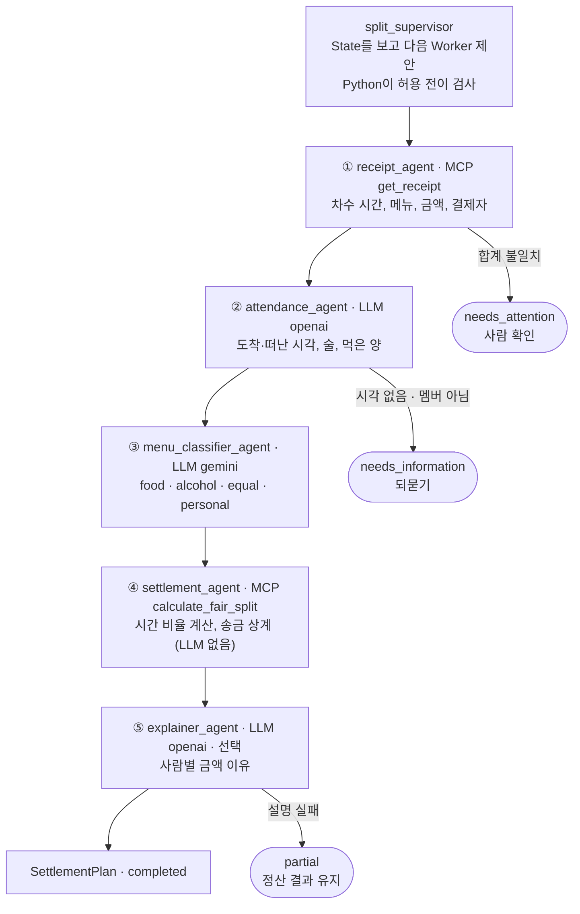

# 공정 N빵 정산 Supervisor–Worker 프로젝트 계획서

- 작성일: 2026-09-30
- 과정: 멀티 에이전트 오케스트레이션 · 03 Supervisor and Router
- 구현 위치: `mini_multi_agent_03_supervisor_router` · Lab 10
- 관련 문서: `docs/lab10/split_worker_definitions.yaml`, `docs/lab10/SCENARIOS_TIME.md`, `SCENARIOS_LAB10.md`, `WORKSHOP_0930_LAB10.md`

---

## 1. 프로젝트 개요

여러 Agent가 영수증·참석 시간·음주·식사량을 나눠 정리하고, 계산은 코드가 맡아 모임 비용을 공정하게 나누는 Supervisor–Worker 시스템을 만든다.

| 항목 | 내용 |
| --- | --- |
| 대상 사용자 | 회식·동아리·친구 모임의 총무 |
| 기술 구성 | Streamlit · FastAPI · FastMCP · PostgreSQL · Redis · OpenAI · Gemini · Ollama |

**해결할 문제**

- 똑같이 N빵하면 술을 안 마신 사람, 조금 먹은 사람, 먼저 간 사람이 손해를 본다.
- 공정하게 나누려면 1차·2차·3차마다 참석 시간을 따지고, 메뉴를 분류하고, 결제자별 송금을 상계해야 해서 계산이 번거롭다.
- 금액의 이유를 설명하기 어려워 정산 뒤에 다시 문의가 생긴다.

**목표**

1. 총무가 문장 하나(예: "서준이는 7시 반에 먼저 갔고 술 안 마셨어")로 정산을 요청한다.
2. Worker가 영수증, 참석 시간, 메뉴 분류를 각자 정리하고 Supervisor가 순서를 관리한다.
3. 금액과 송금 목록은 결정적 계산으로 만들고, 사람마다 금액의 이유를 설명한다.

**범위**: 차수 3개까지, 참석 시각(도착·떠남), 음주 여부, 먹은 양 3단계(적게·보통·많이), 개인 메뉴, 100원 단위 올림, 송금 상계.

**하지 않는 것**: 실제 송금·결제, 계좌 정보 저장, 영수증 이미지 OCR(Mock 원문으로 대체), LLM의 금액 계산.

---

## 2. 업무 시나리오

총무는 모임 번호와 문장 하나를 보내고, 사람별 금액·송금 목록·설명을 받는다.

| 구분 | 내용 |
| --- | --- |
| 입력 | `GATHER-1231 정산해 줘. 서준이는 술 안 마시고 많이 먹었는데 1차에서 7시 반에 먼저 갔어. …` |
| 조회 데이터 | 차수별 영수증(시간·메뉴·금액·결제자), 멤버 목록, 메뉴 분류 사전 (MCP Tool, Mock 데이터) |
| 최종 결과 | 사람별·차수별 금액, 상계한 송금 목록, 사람별 설명 한 문장 (`SettlementPlan`) |
| 종료 상태 | completed · partial(설명만 실패) · needs_information · needs_attention · blocked · failed |

**자동으로 처리하지 않는 작업**

- 시각 없이 "먼저 갔어"라고만 한 경우: 시각을 추측하지 않고 되묻는다.
- 멤버가 아닌 이름이나 차수 시간 밖의 시각: 확인 질문을 보낸다.
- 영수증 메뉴 합계와 인쇄된 합계가 다른 경우: 계산하지 않고 사람에게 넘긴다.
- 송금·결제·문자 발송: 결과만 보여 주고 실행은 총무가 직접 한다.

---

## 3. Agent 설계

Supervisor 1개와 Worker 5개로 나누고, 금액 계산은 LLM이 아닌 MCP Tool Worker가 맡는다. 정의 파일은 `docs/lab10/split_worker_definitions.yaml`이다.

| Agent | 실행 방식 | Tool / Provider | 책임 | 하지 않는 일 | 출력 계약 | 필수 |
| --- | --- | --- | --- | --- | --- | --- |
| split_supervisor | llm | openai | 요청 검증, Worker 순서 관리, 결과 통합 | 금액·시간 추측, Worker 업무 대신 | SettlementPlan | 필수 |
| receipt_agent | mcp | get_receipt | 차수별 시간·메뉴·금액·결제자 확인 | 금액 추측, 합계 맞추기 | ReceiptResult | 필수 |
| attendance_agent | llm | openai (대체 gemini) | 사람별 도착·떠난 시각, 음주, 먹은 양 정리 | 시각 추측, 금액 계산 | AttendanceResult | 필수 |
| menu_classifier_agent | llm | gemini (대체 openai) | 메뉴를 food·alcohol·equal·personal로 분류 | 메뉴 추가·삭제 (금액은 전달받지 않음) | ClassificationResult | 필수 |
| settlement_agent | mcp | calculate_fair_split | 시간 비율 반영 계산, 송금 상계 | 결과 변경, 설명 작성 | SettlementResult | 필수 |
| explainer_agent | llm | openai (대체 gemini) | 사람별 금액 이유 한 문장 | 새 금액 계산 | ExplanationResult | 선택 |

**주요 출력 계약 필드**

- `ReceiptResult`: rounds[ round_id, start, end, payer, items[ label, amount ], printed_total ], unreadable_lines
- `AttendanceResult`: people[ name, drinks, eat(적게·보통·많이), stays[ round_id, arrived_at, left_at ] ], missing_information
- `ClassificationResult`: items[ round_id, label, kind, owner ] (kind가 personal일 때만 owner)
- `SettlementResult`: rows[ name, per_round, total ], transfers[ from, to, amount ], warnings

---

## 4. 오케스트레이션 설계

Supervisor가 State를 보고 Worker를 하나씩 선택하고, 각 Worker 결과는 계약과 Python Guard를 통과해야 다음 단계로 전달된다.



앞 단계 결과가 다음 단계의 입력이라 순차 실행한다. 중단 지점에서는 계산을 하지 않고 멈춘다.

| 패턴 | 적용 위치 |
| --- | --- |
| Supervisor Routing | 다음 Worker 선택, Python이 허용 전이 검사 |
| Sequential + Handoff | 영수증 → 참석 → 분류 → 계산 → 설명, 검증된 결과만 전달 |
| 필수·선택 Worker | explainer_agent만 선택 |
| Human-in-the-loop | 합계 불일치·불확실한 입력은 총무에게 되묻기 |

**State**: gathering_id, receipt, attendance, classification, settlement, explanation, explainer_failed. Worker 하나가 검증을 통과할 때마다 해당 칸이 채워지고, 빈 칸이 다음에 허용되는 Worker를 정한다.

---

## 5. 정산 규칙

차수마다 머문 시간 비율을 구하고, 메뉴 종류별 가중치로 나눈다. 차수에 없던 사람은 비율이 0이라 그 차수 금액이 0원이다.

```text
머문 시간 비율 = 그 차수에서 머문 분 ÷ 그 차수 전체 분
```

| 메뉴 종류 | 가중치 | 나누는 사람 |
| --- | --- | --- |
| food (음식) | 머문 시간 비율 × 먹은 양 (적게 0.5 · 보통 1 · 많이 1.5) | 그 차수 참석자 |
| alcohol (술) | 머문 시간 비율 | 그 차수에서 술 마신 사람만 |
| equal (자리값·노래방·공용 음료) | 머문 시간 비율 | 그 차수 참석자 |
| personal (개인 메뉴) | - | 주인 혼자 |

- 예: 1차 18:00~20:00(120분)에서 19:30에 먼저 가면 비율은 90 ÷ 120 = 0.75이다.
- 받을 돈은 100원 단위로 올리고, 결제자 본인 몫은 올리지 않는다. 올림으로 남는 돈은 결제자 몫이다.
- 차수마다 결제자가 다르면 서로 주고받을 돈을 상계해 한 줄로 만든다.
- 차수에 술 마신 사람이 없는데 술 메뉴가 있으면 참석자 시간 비율로 나누고 경고를 표시한다.

---

## 6. 안전 경계와 오류 대응

LLM은 정리하고 제안만 하며, 순서·권한·계산·종료는 Python이 통제한다.

**안전 경계**

| 규칙 | 적용 방법 |
| --- | --- |
| Tool Allowlist | Worker마다 허용 Tool을 정의하고 `call_tool()`이 검사한다. Mock Tool은 조회 전용이다. |
| 최소 Context | 분류 Agent에는 금액을 주지 않고, 설명 Agent에는 계산 결과만 준다. |
| 허용 전이 | Python이 State로 다음 Worker를 계산하고, Supervisor 선택이 다르면 `invalid_transition`으로 차단한다. |
| 결과 Guard | 영수증 원문에 없는 금액, 합계 불일치, 멤버가 아닌 이름, 차수 시간 밖의 시각, 누락 메뉴, 설명 속 다른 금액을 막는다. |
| 추측 금지 | 빠진 값은 비워 두고 총무에게 되묻는다. |
| 외부 작업 없음 | 송금·결제·발송은 하지 않고 결과만 보여 준다. |

**오류 대응 정책** (정상 LLM 호출 9회 = Supervisor 6 + LLM Worker 3, 재시도 포함 상한 11회 · Timeout 30초 · 최대 2회 시도)

| 상황 | 처리 |
| --- | --- |
| Timeout, 429, 5xx | 같은 Provider 1회 재시도 후 `supported_providers`의 대체 Provider로 전환, 같은 계약으로 재검증 |
| 401·403 인증 오류 | 즉시 중단, 다른 Provider로 숨기지 않음 |
| 출력 계약 위반 | 1회 재생성, 또 실패하면 failed |
| 영수증 합계 불일치 | 재시도하지 않고 needs_attention (사람 확인) |
| 시각 누락·멤버 아님 | needs_information (확인 질문) |
| 필수 Worker 최종 실패 | 다음 단계와 통합 중단, failed |
| explainer_agent 실패 | 설명만 빼고 partial로 완료 |

모든 실행에 `run_id`를 붙이고, Agent 시작·완료·실패, 사용한 Provider·Tool, 지연 시간, Guard 오류를 Redis Trace에 남긴다.

---

## 7. 테스트 시나리오

본 시나리오(S6)에서 총 277,000원을 나누면 하은은 15,200원, 도윤은 81,300원을 낸다. 단순 N빵이면 모두 46,167원이다. 상세는 `docs/lab10/SCENARIOS_TIME.md`에 있다.

**Mock 모임 GATHER-1231 · 연말 팀 회식 (6명)**

| 차수 | 시간 | 결제 | 합계 |
| --- | --- | --- | --- |
| 1차 고깃집 | 18:00~20:00 | 민수 | 156,000원 |
| 2차 호프 | 20:10~22:00 | 지영 | 75,000원 |
| 3차 노래방 | 22:10~23:40 | 도윤 | 46,000원 |

**조건을 하나씩 켜는 시나리오**

| ID | 조건 | 확인할 결과 |
| --- | --- | --- |
| S1 | 모두 끝까지·술·보통 | 45,233~49,300원, 개인 메뉴만큼만 차이 |
| S2 | 서준·하은 술 안 마심 | 둘 다 17,400원 감소 |
| S3 | 도윤 많이, 지영 적게 | 도윤 +11,100원, 지영 −11,084원 |
| S4 | 서준 1차만, 지영·하은 2차까지 | 빠진 차수 0원, 3차 몫 7,700 → 15,400원 |
| S5 | 서준 19:30 먼저 감, 채원 18:30 도착·23:00 먼저 감 | 서준 −4,000원, 채원 −7,700원 |
| S6 | 위 조건 모두 | 아래 표 |

**S6 본 시나리오 기대 결과**

| 이름 | 참석·조건 | 1차 | 2차 | 3차 | 합계 |
| --- | --- | ---: | ---: | ---: | ---: |
| 도윤 (3차 결제) | 끝까지, 술, 많이 | 41,800 | 21,500 | 18,000 | 81,300 |
| 민수 (1차 결제) | 끝까지, 술, 보통 | 32,310 | 17,900 | 18,000 | 68,210 |
| 채원 | 1차 18:30 도착, 3차 23:00 먼저 감, 술 | 24,300 | 17,900 | 10,000 | 52,200 |
| 지영 (2차 결제) | 2차까지, 술, 적게 | 22,900 | 14,167 | 0 | 37,067 |
| 서준 | 1차 19:30 먼저 감, 술 X, 많이 | 23,400 | 0 | 0 | 23,400 |
| 하은 | 2차 21:00 먼저 감, 술 X, 적게 | 11,500 | 3,700 | 0 | 15,200 |

송금은 상계 후 9줄이다 (예: 도윤 → 민수 23,800원, 채원 → 도윤 10,000원). 금액은 5장 규칙으로 계산기를 직접 돌려 검산했다.

**예외 시나리오**

| ID | 상황 | 멈추는 곳 | 기대 상태 |
| --- | --- | --- | --- |
| E1 | "서준이는 먼저 갔어" (시각 없음) | attendance_agent | needs_information |
| E2 | 1차 종료(20:00) 뒤인 21:00에 1차에서 갔다고 함 | attendance_agent | needs_information |
| E3 | 도착 시각이 떠난 시각보다 늦음 | 계약 검증 | 1회 재생성 후 needs_information |
| E4 | 3차에 아무도 술 안 마셨는데 캔맥주 있음 | settlement_agent | completed + 경고 |
| E5 | 2차에 없던 서준이 제로콜라 주인 | 분류 Guard | needs_information |
| E6 | 영수증 한 줄 판독 불가 (합계 불일치) | receipt_agent | needs_attention |
| E7 | 멤버가 아닌 "은비" 등장 | attendance_agent | needs_information |
| E8 | explainer_agent 시간 초과 | explainer_agent | partial |
| E9 | Supervisor가 순서를 건너뜀 | Python 전이 검사 | blocked |

---

## 8. 구현 현황과 완료 기준

차수 단위 정산(Lab 10)은 03 프로젝트에 구현됐고 자동 테스트 16개가 통과한다. 남은 일은 머문 시간 비율 확장과 실제 LLM 실행 검증이다.

**구현 단계**

| 순서 | 작업 | 주요 파일 | 상태 |
| --- | --- | --- | --- |
| 1 | Worker 선언 | `agents/definitions/workers.yaml`, `docs/lab10/split_worker_definitions.yaml` | 완료 |
| 2 | Registry·Loader 등록 | `split_supervisor_agent.py`, `registry.py`, `loader.py` | 완료 |
| 3 | Mock MCP Tool 3개 | `mcp_server/tools/split_tools.py`, `mock_data/split_gatherings.json` | 완료 |
| 4 | Orchestration·계산 (차수 단위) | `orchestration/split_flow.py`, `split_calculator.py` | 완료 |
| 5 | Router·Swagger·Streamlit 화면 | `routers/workflow.py`, `frontend/app.py` · 메뉴 10 | 완료 |
| 6 | 머문 시간 비율 확장 | GATHER-1231 데이터, 도착·떠난 시각 계약, `calculate_fair_split` Tool | 예정 |
| 7 | Provider Failover | `supported_providers` 기반 대체 호출 | 예정 |
| 8 | 실제 LLM 실행 검증 | 로컬 PC에서 Swagger 순서대로 실행 | 예정 |

**완료 기준 점검표** (제안서 7장 기준)

| 완료 기준 | 이 프로젝트에서 | 상태 |
| --- | --- | --- |
| Agent별 역할과 책임 분리 | Supervisor 1 + Worker 5, 하지 않는 일 명시 | 완료 |
| 출력이 구조화 계약으로 검증 | Pydantic 계약 + Python Guard | 완료 |
| Routing·Parallel·Join·Handoff 중 2개 이상 | Supervisor Routing + 순차 Handoff | 완료 |
| Tool 권한을 코드에서 강제 | Worker별 allowed_tools, `call_tool()` 검사 | 완료 |
| 최소 Context만 전달 | 분류 Agent에 금액 미전달 (테스트로 확인) | 완료 |
| 변경·외부 작업 전 승인 | 송금·발송 없음, 불확실하면 사람 확인 | 완료 |
| Timeout과 최대 재시도 | 30초, 최대 2회 | 예정 |
| 대체 경로와 중단 조건 | supported_providers 대체, 인증 오류 즉시 중단 | 예정 |
| 사용한 Provider·Tool이 Trace에 남음 | Redis Trace, 화면 표시 | 완료 |
| 필수·선택 실패 정책 구분 | explainer_agent만 선택 (partial) | 완료 |
| 정상·부분 실패·전체 실패·승인 거부 테스트 | Lab 10 테스트 16개 통과, 시간 비율 시나리오 테스트는 예정 | 진행 중 |
